<h1 data-importer="text" align="left">💫 Sobre</h1>

###

✨Estudante de Ciência da Computação no UniCEUB  Estrutura do repositório  /academicos -> projetos da faculdade /pessoais -> projetos pessoais

###

  
  

###

<h3 data-importer="text" align="left">Projetos</h3>

###

FightLab(Privado): FightLab é um app de estudo de MMA que encontra lutadores parecidos com você e recomenda lutas com base no seu perfil e nas suas dificuldades técnicas. Explore estatísticas, gere roteiros de estudo com IA e salve lutas para analisar depois.

###

<h1 data-importer="text" align="left">🎯​Skills</h1>

###

<h3 data-importer="text" align="left">Programming Languages</h3>

###

  
  
  
  
  
  
  
  
  
  
  

###

<h3 data-importer="text" align="left">Databases</h3>

###

  
  
  
  
  
  
  
  
  
  
  

###

<h3 data-importer="text" align="left">Cloud Computing</h3>

###

  
  
  

###

<h3 data-importer="text" align="left">DevOps & Infrastructure</h3>

###

  
  
  
  
  
  
  
  
  

###

<h3 data-importer="text" align="left">Frameworks & Web Development</h3>

###

  
  
  
  
  
  
  
  
  
  
  
  
  
  
  

###

###

  
  

###

###
